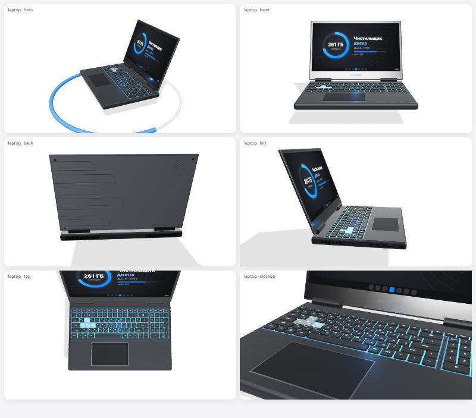

# Чистильщик диска

Портативная программа для очистки диска в Windows. Внутри — локальный сервер на Python (только стандартная библиотека) и интерфейс в браузере: белый дизайн в стиле Apple, 3D-модели на three.js. Ничего не устанавливает и ничего не отправляет в интернет.



## Возможности

- **Очистка системы** — 112 категорий: временные файлы и логи Windows, журналы событий, кэш обновлений, дампы, Корзина; кэши браузеров (Chrome, Edge, Яндекс, Opera, Firefox и др.), Telegram, Discord, Steam, Epic, Battle.net, Roblox, Minecraft, Spotify, драйверов NVIDIA/AMD, инструментов разработчика. Показываются только установленные программы.
- **Мусор и копии** — временные и служебные файлы, недокачанные загрузки, бэкапы, пустые файлы и папки, битые ярлыки, старые установщики. Распознаёт копии вида «файл (2)», «Копия», «Copy of», «копія», «Kopie», «副本» — на 25+ языках.
- **Дубликаты** — одинаковые файлы в разных папках (сверка хэшем BLAKE2), сгруппированы; можно выбрать, какую копию оставить. Одна копия остаётся всегда.
- **Бесполезные файлы** — то, что не открывалось дольше N дней, с фильтром по размеру и типу.
- **Старые игры** — Steam (последний запуск и наигранные часы), Epic, GOG, Ubisoft, EA, Battle.net, Riot, Xbox. Удаление идёт через сам лаунчер, с его подтверждением. 3D-полка с обложками.
- **Анализ места** — 3D-карта папок, проваливание внутрь.
- **Диски** — тип (SSD/NVMe/HDD), модель, состояние, TRIM/дефрагментация, проверка.
- **Результаты** — сколько места освободила программа: история, по дням, по категориям.
- **Тест-мастер** при первом запуске — спрашивает, что чистить, и сам запускает нужные поиски.

## Запуск

**Готовая сборка.** Распакуйте архив целиком и запустите `Запустить Чистильщик.bat`. В окне консоли появится адрес `http://localhost:8770`, браузер откроется сам. Окно консоли — это и есть программа, не закрывайте его.

**Из исходников** (Python 3.10+, Windows):

```bash
python cleaner.py
```

Ключи: `--port 8770`, `--no-browser`, `--selftest` (проверка без удаления файлов).

## Сборка портативной версии

```bash
python build.py
```

Скрипт собирает `portable/Чистильщик диска/` и `Чистильщик-диска.zip`: копирует официальный `python.exe` из установленного Python (с цифровой подписью Python Software Foundation), урезанную стандартную библиотеку, программу и `.bat`. В конце сам прогоняет selftest и проверяет, что сервер отвечает.

PyInstaller не используется: его exe Защитник Windows ложно определял как `Trojan:Win32/Wacatac.B!ml`.

## Безопасность

- Сервер слушает только `127.0.0.1`. Запросы с других сайтов отклоняются: проверяются `Host` и `Origin`, изменяющие запросы требуют служебный заголовок.
- Найденные файлы по умолчанию уходят в Корзину. Есть «Пробный прогон» — показывает, сколько освободится, ничего не удаляя.
- Поиск мусора не заходит в Windows, Program Files, ProgramData и AppData. Логины и история браузеров, сохранения игр и миры Minecraft не трогаются.
- Игры удаляются только через их лаунчер или деинсталлятор.

## Структура

| Путь | Что это |
|---|---|
| `cleaner.py` | ядро: категории, сканеры, HTTP-сервер и API |
| `ui/` | интерфейс: `index.html`, `app.js`, `app.css`, `scenes.js` (3D) |
| `ui/vendor/` | three.js r160 |
| `ui/dev-models.html` | служебная страница: 3D-модели с разных ракурсов |
| `build.py` | сборка портативной версии |
| `portable/ПРОЧИТАЙ.txt` | инструкция, которая кладётся в архив |

История очисток хранится в `cleaner_data.json` рядом с программой и в репозиторий не попадает.

## Сторонние компоненты

- [three.js](https://threejs.org) r160 — лицензия MIT (`ui/vendor/LICENSE`).
- Портативная сборка содержит Python — лицензия PSF (`PYTHON-LICENSE.txt` рядом с рантаймом).
